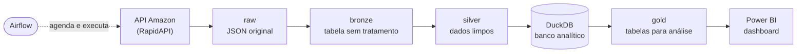

# Pipeline de Preços da Amazon BR

Projeto de engenharia de dados que acompanha os **preços de produtos da Amazon Brasil**.

Os dados saem de uma API, passam por várias etapas de limpeza e organização, são guardados em um banco de dados analítico e terminam em um **dashboard no Power BI**. Tudo pode ser executado por um **orquestrador (Airflow)**.

O objetivo é mostrar, em um projeto pequeno, o **ciclo de vida completo dos dados**: coletar, guardar, tratar, modelar, monitorar, automatizar e apresentar.

---

## Como funciona



Os dados passam por **camadas**, e cada camada tem uma função. Essa organização é chamada de **arquitetura medalhão** (bronze, prata e ouro):

| Camada | O que guarda | Formato |
|---|---|---|
| **raw** | A resposta da API exatamente como chegou, sem nenhuma alteração | JSON |
| **bronze** | Os mesmos dados, mas em formato de tabela, com informações de quando e de onde vieram | Parquet |
| **silver** | Dados limpos: preços viram números, colunas ganham nomes claros, produtos repetidos são removidos | Parquet |
| **gold** | Tabelas prontas para o dashboard: produtos, preços por dia, maiores descontos, histórico de preços | DuckDB |

> **Por que separar em camadas?** Se algo der errado na limpeza, não é preciso chamar a API de novo: basta reprocessar a partir da bronze. A camada raw é a "cópia de segurança" do que a API entregou.

---

## Tecnologias

| Ferramenta | Para que serve aqui |
|---|---|
| **Python** (pandas, requests, tenacity) | Coletar e tratar os dados |
| **Parquet** | Guardar as camadas bronze e silver em formato colunar (leve e rápido para análise) |
| **DuckDB** | Banco de dados analítico que roda em um único arquivo, sem servidor |
| **SQL** | Montar as tabelas da camada gold |
| **Airflow** (Docker) | Orquestrar: agendar e executar o pipeline, com histórico de execuções |
| **Power BI** | Dashboard com indicadores, vitrine de produtos e evolução de preços |
| **uv** | Gerenciar o ambiente e as dependências do Python |

---

## Estrutura de pastas

```
pipeline-dataamazon-api/
├── src/                    # código do pipeline
│   ├── config.py           #   caminhos e categorias
│   ├── extract.py          #   API -> raw
│   ├── ingest.py           #   raw -> bronze
│   ├── transform.py        #   bronze -> silver
│   ├── load.py             #   silver -> DuckDB, checagens de qualidade e gold
│   ├── vitrine.py          #   imagens e "cartas" de produto para o Power BI
│   └── observabilidade.py  #   registro de tempo e status de cada etapa
├── sql/gold/               # consultas SQL que criam as tabelas da camada gold
├── orquestracao/           # Airflow: DAGs, Dockerfile e docker-compose
├── powerbi/                # relatório Power BI no formato de projeto (.pbip)
├── notebooks/              # análise exploratória inicial dos dados
├── scripts/                # script usado uma única vez para migrar dados antigos
├── config/.env.example     # modelo do arquivo com a chave da API
├── main.py                 # executa o pipeline pelo terminal
└── data/                   # dados gerados (não vão para o GitHub)
```

---

## Destaques do projeto

**Carga sem duplicar dados**
Cada dia de extração é uma "partição". Ao reprocessar um dia, a partição antiga é substituída pela nova. Rodar o pipeline duas vezes não duplica nada.

**Checagens de qualidade**
Antes de montar a camada gold, o pipeline confere regras simples, como produto sem código, produto duplicado, preço zerado ou nota fora de 0 a 5. Se alguma regra falhar, ele para e avisa.

**Registro de tempo (observabilidade)**
Cada etapa grava em uma tabela (`ops.execucoes`) quando começou, quanto tempo levou, quantos registros processou e se deu erro. Cada produto também guarda **quando foi extraído, ingerido, processado e carregado**. Com isso dá para saber o quão "frescos" estão os dados e onde o pipeline está lento.

**Tratamento de erros da API**
Se a API falhar ou recusar por excesso de chamadas, o pipeline tenta de novo automaticamente, esperando um pouco mais a cada tentativa.

**Orquestração com Airflow**
- `pipeline_amazon_diario`: roda todo dia às 9h. Vem **pausado**, porque o plano gratuito da API tem poucas chamadas por mês.
- `pipeline_amazon_reprocessar`: refaz tudo a partir dos dados já salvos, **sem chamar a API**.
- Como o DuckDB só aceita uma escrita por vez, as tarefas usam um *pool* de uma vaga. Assim elas se revezam em vez de dar erro.

**Dashboard no Power BI**
- **Visão Geral**: indicadores principais (produtos monitorados, preço médio, desconto médio, nota média), produtos por faixa de preço e maiores descontos.
- **Vitrine**: grade de "cartas" com foto, nome, preço original riscado, preço com desconto e nota. Dá para filtrar por data e ordenar por maior desconto, maior preço ou menor preço.
- **Evolução do Produto**: escolha um produto e veja como o preço, o desconto e a nota mudaram entre as extrações.

---

## Como executar

### 1. Pré-requisitos
- [uv](https://docs.astral.sh/uv/) (gerenciador de Python)
- Uma chave gratuita da API [Real-Time Amazon Data](https://rapidapi.com/letscrape-6bRBa3QguO5/api/real-time-amazon-data) na RapidAPI
- Opcional: [Docker Desktop](https://www.docker.com/products/docker-desktop/) (para o Airflow) e [Power BI Desktop](https://www.microsoft.com/power-platform/products/power-bi/desktop) com o [driver ODBC do DuckDB](https://duckdb.org/docs/stable/clients/odbc/windows)

### 2. Instalar e configurar
```bash
git clone https://github.com/grmarttins/pipeline-dataamazon-api.git
cd pipeline-dataamazon-api
uv sync
```
Copie `config/.env.example` para `config/.env` e coloque a sua chave da API.

### 3. Rodar o pipeline pelo terminal
```bash
uv run python main.py                 # busca os dados de hoje e atualiza todas as camadas
uv run python main.py --pages 3       # busca 3 páginas de produtos por categoria
uv run python main.py --reprocessar   # refaz tudo com os dados já salvos, sem chamar a API
```
Os dados ficam em `data/`, e o banco em `data/warehouse.duckdb`.

### 4. Rodar com o Airflow (opcional)
```bash
cd orquestracao
docker compose up -d --build
```
Abra **http://localhost:8081**, entre em **Dags**, escolha uma DAG e clique em **▶ Trigger**.

### 5. Abrir o dashboard (opcional)
Abra `powerbi/AmazonPrecos.pbip` no Power BI Desktop e clique em **Atualizar**. Se o projeto estiver em outra pasta, ajuste o caminho do banco em *Transformar dados → Parâmetros → CaminhoBanco*.

> O DuckDB não deixa dois programas escreverem no banco ao mesmo tempo. Feche o Power BI (ou outro programa conectado ao banco) antes de rodar o pipeline.

---

## Limitações e próximos passos

- A API gratuita tem poucas chamadas por mês, por isso há poucas datas de extração e só uma categoria ativa. Outras categorias já estão prontas em `src/config.py`, só esperando para serem ativadas.
- Próximos passos possíveis:
  - levar o banco para a nuvem (BigQuery ou MotherDuck);
  - adicionar testes automatizados;
  - gerar a camada gold com dbt.
